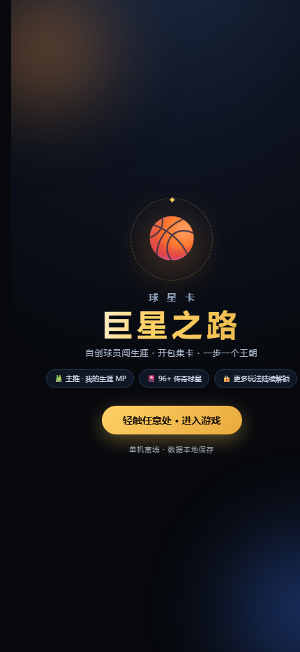

# 巨星之路 · 球星光卡

一个单文件 H5 篮球卡牌游戏：自创球员，开包集卡，走完一段生涯。



## 玩法

- **我的生涯 MP**：自建球员，从新秀打到退役，属性随比赛成长
- **96+ 传奇球星**：开包、集卡、组阵容
- **单机离线**：不联网、不登录，进度存在浏览器本地

## 怎么玩

直接打开：<https://tlac12345.github.io/juxing-zhilu/>

手机上建议「添加到主屏幕」，全屏体验更好。

## 技术

- 纯前端，单个 `index.html`（约 580 KB），零依赖、零构建
- 数据存 `localStorage`，清缓存会丢档
- 适配移动端安全区与刘海屏

## 本地运行

```bash
# 随便一个静态服务器都行
python -m http.server 8000
# 然后打开 http://localhost:8000
```

## 声明

个人作品，非商业用途。球星名称与形象仅作致敬，与任何球队、联盟、球员无关联。
