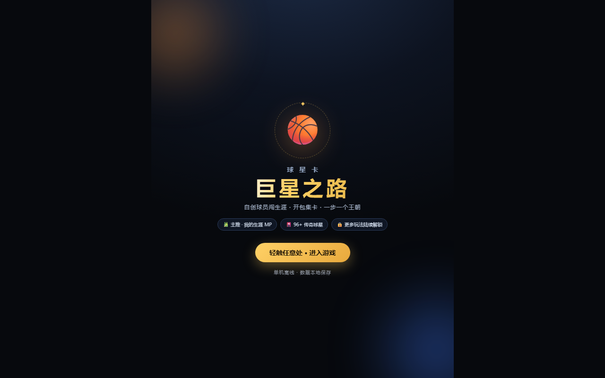
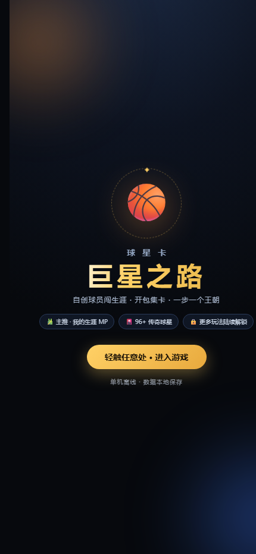

# 巨星之路 · 球星光卡 · Hoops Legend

> 一句话：一个**单文件 H5 篮球卡牌游戏**——自创球员，开包集卡，走完一段生涯。

 

**在线玩**：<https://tlac12345.github.io/juxing-zhilu/> · 手机上「添加到主屏幕」全屏体验更好。

---

## 中文

### 这是什么

自建一名球员，从新秀打到你退役。比赛涨属性，开包抽球星，凑一套阵容去打下一个赛季。单机、离线、不登录。

### 玩法

| 模块 | 说明 |
|---|---|
| **我的生涯 MP** | 自建球员（位置 / 属性 / 名字），从新秀打到退役，属性随比赛成长 |
| **96+ 传奇球星** | 开包、集卡、组阵容；不同组合对应不同打法 |
| **比赛** | 用你抽到的牌组打比赛，赢了拿资源和新的包 |
| **本地存档** | 进度存在浏览器 `localStorage`，换设备不跟随 |

### 怎么玩

```bash
# 在线（推荐）
# 直接打开 https://tlac12345.github.io/juxing-zhilu/

# 本地
python -m http.server 8000
# 然后浏览器打开 http://localhost:8000
```

### 技术

- 纯前端，单个 `index.html`（约 580 KB），**零依赖、零构建**
- 数据存 `localStorage`，清缓存会丢档
- 适配移动端安全区与刘海屏

---

## English

A single-file HTML5 **basketball card game**. Create your own player, open packs to collect legends, and play out a full career — offline, no account, no build step.

- **Single file** — one `index.html` (~580 KB), zero dependencies
- **Career mode** — a rookie you create, stats growing game by game until retirement
- **96+ legend cards** — open packs, collect, build lineups
- **Play now**: <https://tlac12345.github.io/juxing-zhilu/>

Progress is stored in `localStorage`, so clearing site data resets your save.

---

## 声明 / Notice

个人作品，非商业用途。球星姓名与形象仅作致敬，与任何球队、联盟、球员无关联。
Personal project, non-commercial. Player names and likenesses are used as tribute only; this project is not affiliated with any team, league or player.
